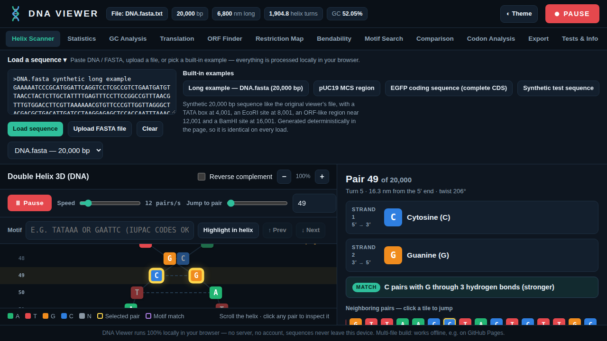
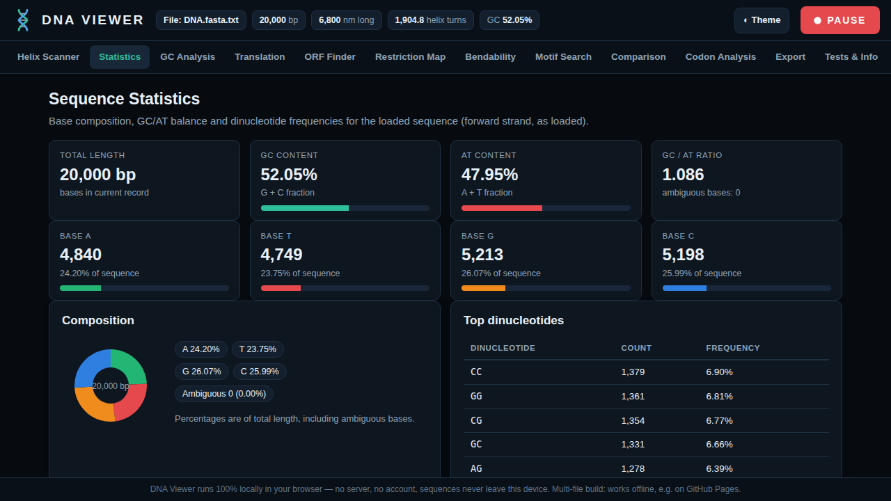

# DNA Viewer

**Interactive Double Helix Scanner and DNA Sequence Analysis Platform**

Paste a sequence or upload a FASTA file, and watch it become a living double helix you can scan pair by pair, then run real bioinformatics analyses on the same sequence, all in your browser, in a small multi-file project with no build step.


> No install. No backend. No account. No API key. No data leaves your device.
> Download the project, open index.html in a browser, and it works, even offline.

## Screenshots



*Helix Scanner home view: the double helix with pair 49 of 20,000 selected, scanning at 12 pairs per second.*



*Statistics tab: base composition, GC/AT balance and dinucleotide frequencies for the 20,000 bp example.*

## Contents

- [Why DNA Viewer](#why-dna-viewer)
- [Screenshots](#screenshots)
- [Highlights](#highlights)
- [Features](#features)
- [Built-in examples](#built-in-examples)
- [Quick start](#quick-start)
- [Deploy on GitHub Pages](#deploy-on-github-pages)
- [How to use](#how-to-use)
- [Scientific notes](#scientific-notes)
- [Self-tests](#self-tests)
- [Limitations](#limitations)
- [Project structure](#project-structure)
- [Tech stack](#tech-stack)
- [Privacy](#privacy)
- [Contributing](#contributing)
- [License](#license)
- [Author](#author)

## Why DNA Viewer

A raw DNA sequence is just endless lines of A, T, G and C. It is hard to read, hard to teach from, and hard to spot patterns in.

Most simple viewers solve only half of that problem: they colour the letters and stop there.

DNA Viewer goes further:

1. **It shows the molecule, not just the text.** The home screen is a vertical B-DNA double helix with two antiparallel strands, turn numbers, and major and minor groove labels.
2. **It scans like an instrument.** Press SCANNING and the viewer moves pair by pair through the sequence. Click any pair and the side panel explains that exact pair.
3. **It is also an analysis suite.** Statistics, GC content, six-frame translation, ORF finding, restriction mapping, bendability, motif search, sequence comparison and codon usage are built in, not bolted on.
4. **It stays honest.** Predicted ORFs are labelled as predictions, not genes. Limitations are listed inside the app itself.

It is designed for molecular biology researchers, microbiologists, genetics researchers, bioinformatics students, computational biologists and biotechnology professionals, and for anyone teaching DNA structure in a classroom.

## Highlights

- **Multi-file project:** a small, organised codebase: `index.html` plus `style.css` and three JavaScript files. No build step, no `node_modules`, no external libraries to load.
- **Virtualized helix:** only the base pairs on screen are drawn, so a 20,000 bp sequence scrolls smoothly instead of freezing the browser.
- **Helix-first, tools included:** the scanner is the home view, and every analysis is one tab away.
- **Dark and light modes:** one click in the top bar.
- **Fully responsive:** desktop, tablet and mobile layouts.
- **Export everything:** FASTA, statistics CSV, ORF CSV, restriction CSV, motif CSV, GC window CSV, translation text, GC chart SVG and a helix snapshot PNG.
- **Works offline:** open `index.html` once and it keeps working without a connection.

## Features

### 1. Double Helix Scanner (home view)

- Vertical double helix with colour-coded tiles on both strands
- Position number, helix turn number and groove label on every row
- Click any base pair to inspect it: Strand 1 (5' to 3'), Strand 2 (3' to 5'), base names, MATCH status and hydrogen bonds (A-T: 2 bonds, G-C: 3 bonds)
- Neighbouring-pairs strip: click a tile to jump to that pair
- Auto-scan with the SCANNING button, with speed control from 1 to 120 pairs per second
- Jump to any pair by slider, by number, or by clicking the mini GC chart
- Zoom in and out on the helix
- Reverse complement toggle: flip the whole view in one click
- Motif highlighting directly inside the helix, with Previous and Next match navigation
- Live mini statistics, base composition bars and a clickable GC mini chart beside the helix
- Helix Facts panel: rise 3.4 Angstrom per base pair, 10.5 bp per turn, pitch 34 Angstrom, diameter 2.0 nm, right-handed, antiparallel strands

### 2. Sequence input and FASTA management

- Paste a raw sequence or full FASTA text
- Upload `.fa`, `.fasta`, `.fna` or `.txt` files with the browser File API
- Multiple FASTA records are preserved with their identifiers and descriptions, and can be switched from the record picker
- Input validation with clear error messages

### 3. Sequence Statistics

- Total length, A / T / G / C counts and percentages
- GC percentage, AT percentage, GC/AT ratio
- Ambiguous nucleotide count
- Nucleotide composition charts and dinucleotide frequencies

### 4. GC Content Analysis

- Sliding-window GC percentage with custom window size and step size
- Interactive chart: hover to read the GC value at each genomic position
- Download the chart as SVG and the window data as CSV

### 5. Translation and Reverse Complement

- Six-frame translation: three forward frames and three reverse frames
- Four genetic codes: Standard (NCBI 1), Vertebrate Mitochondrial (NCBI 2), Yeast Mitochondrial (NCBI 3), and Bacterial / Plant Plastid (NCBI 11)
- Start and stop codons highlighted in the amino acid view
- Ambiguous codons are expanded over all IUPAC possibilities in every translation path: if every possibility gives the same result, that result is shown (for example `GGN` shows G, `CAR` shows Q, `ATH` shows I, and `TAR` shows a stop), and X appears only when the result is genuinely uncertain (for example `ATN`)
- No display cap: translations are shown in paginated blocks of 600 bp with Previous and Next navigation and a Show more option to display all blocks, and the downloadable translation always covers the full sequence
- Reverse complement with full IUPAC ambiguity code support, downloadable as FASTA

### 6. ORF Finder

- Open reading frames in all six reading frames, sorted by length
- Start-codon setting: ATG only, or ATG + GTG + TTG for bacterial alternative starts. When GTG or TTG is used, the first residue is translated as M (formyl-Met), as in real bacterial translation
- Start and end coordinates, strand, frame, the start codon used (shown in every ORF row), length in nucleotides and amino acids, stop codon and protein sequence
- Adjustable minimum ORF length
- Click an ORF row to jump to it in the Helix Scanner, copy its protein, or download all ORFs as CSV

> **Predicted, not proven.** An ORF is a computational prediction. It is not necessarily a functional gene: real genes also need promoter context, a ribosome binding site and experimental evidence. The app states this in the ORF view itself.

### 7. Restriction Map

Ten common enzymes, searched on both strands, with cut positions and fragment sizes:

| Enzyme | Recognition site | Enzyme | Recognition site |
| --- | --- | --- | --- |
| EcoRI | GAATTC | PstI | CTGCAG |
| BamHI | GGATCC | SmaI | CCCGGG |
| HindIII | AAGCTT | KpnI | GGTACC |
| NotI | GCGGCCGC | SalI | GTCGAC |
| XhoI | CTCGAG | HaeIII | GGCC |

- Linear and circular DNA maps drawn as SVG
- Fragment sizes calculated for a digest in both modes
- Sites downloadable as CSV, and the enzyme list is a simple array in the code, so adding an enzyme is one line
- A verified isoschizomers reference table, and an Isoschizomers column in the cut-sites results. Isoschizomers recognise the same sequence and cut at the same position; neoschizomers recognise the same sequence but cut at a different position, and are labelled as such:

| Enzyme | Isoschizomers |
| --- | --- |
| EcoRI | none known |
| BamHI | BstI |
| HindIII | none known |
| NotI | CciNI |
| XhoI | PaeR7I |
| PstI | Bsp63I |
| SmaI | XmaI (neoschizomer, different cut site) |
| KpnI | Acc65I (neoschizomer, different cut site) |
| SalI | none known |
| HaeIII | BsuRI |

### 8. Motif Search

- Search one motif in the scanner, or many motifs at once (one per line) in the Motif Search tab
- Full IUPAC ambiguity codes supported: for example `TATAAA`, `GAATTC`, `ANG` (N = any base)
- Overlapping matches are reported, with position, matched sequence and frequency
- Optional circular DNA mode for wrap-around matches
- Every match can be opened directly in the helix, and results export as CSV

### 9. Sequence Comparison

- Needleman-Wunsch global alignment by default, with scoring match +1, mismatch -1, gap -2: gaps are inserted so similar regions line up even when bases were inserted or deleted
- Results show the two aligned sequences, percentage identity, matches, mismatches, gap columns and the alignment score
- Alignment is capped at 5,000 bp per sequence to keep the browser responsive; longer inputs are refused with an on-screen message
- The original position-by-position overlay remains available as a secondary view, selectable in the Method dropdown

### 10. DNA Bendability

- Detects A-tracts and T-tracts: runs of 4 or more consecutive A or T bases
- Detects bend-prone AT-rich windows: 50 bp windows with 70% or more A+T
- Tracts are highlighted in the sequence view and listed in a table with start, end, length and sequence, each with a View in helix button that jumps to that position in the Helix Scanner
- Bend-prone windows are listed as position pills with their A+T percentage
- The helix view itself keeps ideal B-DNA geometry (10.5 bp per turn): this tab finds the bend-prone regions in the sequence, it does not redraw the helix bent

### 11. Codon Usage and Composition

- Codon frequencies for a chosen forward reading frame
- Relative Synonymous Codon Usage (RSCU), where 1.0 means no bias within a synonymous family
- Codon table downloadable as CSV

## Built-in examples

No test file handy? Four examples are built in, so the app can be tried in one click:

| Example | What it shows |
| --- | --- |
| Long example, 20,000 bp | A synthetic 20,000 bp sequence like a real `DNA.fasta` file, generated deterministically in the page so it is identical on every load. Landmarks are planted at known spots: a TATA box at 4,001, an EcoRI site at 8,001, an ORF-like region near 12,001 and a BamHI site at 16,001. Use it to test scrolling, scanning and jumping. |
| pUC19 MCS region | The real multiple cloning site region of the pUC19 cloning vector, with EcoRI, BamHI, HindIII, KpnI, SmaI, PstI, SalI and XhoI sites in their real order. Use it to test the Restriction Map. |
| EGFP coding sequence | The real complete EGFP coding sequence, 720 bp including the stop codon, starting with ATG. The ORF Finder reports one long 720 nt ORF on frame +1. Use it to test translation and ORF finding. |
| Synthetic test sequence | A constructed sequence with a known ORF, an EcoRI site, a BamHI site, a TATA-box motif and ambiguous bases (N, R, Y). Use it to check IUPAC handling. |

## Quick start

### Option 1: open it locally (fastest)

1. Download this repository (Code, then Download ZIP) and unzip it.
2. Double-click `index.html`, or drag it into any modern browser (Chrome, Edge, Firefox or Safari).
3. Click a built-in example, or paste your own sequence, and press SCANNING.

That is all. There is nothing to install.

### Option 2: run a local server (optional)

```bash
# Python 3
python3 -m http.server 8000
# then open http://localhost:8000/
```

## Deploy on GitHub Pages

Deployment takes about a minute:

1. Create a new GitHub repository, for example `dna-viewer`.
2. Upload all the project files to the repository root: `index.html`, `README.md`, `style.css`, `bio.js`, `helix.js`, `tools.js`, `helix-scanner.png` and `statistics.png`.
3. In the repository, go to **Settings, then Pages**.
4. Under **Build and deployment**, choose **Deploy from a branch**, select the `main` branch and the `/ (root)` folder, and save.
5. Wait for GitHub to publish the site, then open the Pages URL shown in that same Settings page.

Every push to `main` republishes the site automatically. No build settings, workflows or dependencies are needed.

## How to use

1. **Load a sequence.** Paste a sequence or FASTA text, upload a file, or pick a built-in example. For a multi-record FASTA, choose the record from the picker.
2. **Scan the helix.** Press SCANNING to move pair by pair, adjust the speed slider, or use Jump to pair to go straight to a position. Click any pair for its detail panel.
3. **Find a motif in the helix.** Type a motif such as `TATAAA` or `GAATTC` in the Motif box, press Highlight in helix, then step through matches with Previous and Next.
4. **Run an analysis.** Open the Statistics, GC Analysis, Translation, ORF Finder, Restriction Map, Bendability, Motif Search, Comparison or Codon Analysis tab.
5. **Export.** Use the buttons beside the helix for FASTA, statistics CSV and a PNG snapshot, or open the Export tab for every download in one place. Run an analysis first so its export has content.

## Scientific notes

### Nucleotide colours (used everywhere in the app)

| Base | Name | Colour |
| --- | --- | --- |
| A | Adenine | Green |
| T | Thymine | Red |
| G | Guanine | Orange |
| C | Cytosine | Blue |
| N | Unknown / ambiguous | Grey |

### B-DNA geometry used in the helix view

| Property | Value |
| --- | ---: |
| Rise per base pair | 3.4 Angstrom (0.34 nm) |
| Base pairs per turn | 10.5 |
| Pitch per full turn | 34 Angstrom |
| Diameter | 2.0 nm |
| Major groove width | 2.2 nm |
| Minor groove width | 1.2 nm |
| Handedness | Right-handed |
| Strand orientation | Antiparallel |

So a 20,000 bp sequence is 6,800 nm long and makes about 1,904.8 helix turns, which is exactly what the top bar of the app reports.

### Accuracy rules followed

- Complementarity and reverse complement follow standard base pairing, including IUPAC ambiguity codes (R pairs with Y, K with M, B with V, and so on).
- Translation uses the selected NCBI genetic code table. Codons containing ambiguous bases are expanded over all IUPAC possibilities: the amino acid (or stop) is shown when every possibility agrees, and X is shown only when the possibilities genuinely disagree.
- ORF start codons are ATG by default, with an optional ATG + GTG + TTG setting; a GTG or TTG start is translated with M as its first residue.
- Sequence comparison uses Needleman-Wunsch global alignment with match +1, mismatch -1 and gap -2, capped at 5,000 bp per sequence.
- Bendability calls an A-tract or T-tract at 4 or more consecutive A or T bases, and a bend-prone window at 70% or more A+T in a 50 bp window.
- GC percentage is (G + C) / total bases x 100, calculated per window for the GC chart.
- Restriction cut positions follow each enzyme's standard top-strand cleavage offset, and sites are searched on both strands.
- Coordinates are 1-based throughout, as in standard bioinformatics tools.

## Self-tests

The app ships with its own validation suite. Open the **Tests and Info** tab and press **Run tests**: the real analysis functions are run on sequences with known answers, covering:

- FASTA parsing and base counting
- GC percentage
- Reverse complement, including IUPAC codes
- Translation in the standard code, and TGA coding for W in the vertebrate mitochondrial code
- Ambiguous codon resolution: `GGN` to G, `CAR` to Q, `ATH` to I, `TAR` to stop, and genuinely uncertain `ATN` to X
- ORF detection, including a GTG start found only in the ATG + GTG + TTG mode, with its first residue coded as M, and ignored in ATG-only mode
- EcoRI site position and cut position
- Isoschizomer data: KpnI lists Acc65I, HaeIII lists BsuRI, XhoI lists PaeR7I, and EcoRI lists none known
- Overlapping and circular motif search
- Linear and circular restriction fragment sizes
- Needleman-Wunsch alignment: identical sequences at 100% identity, a gap inserted for an insertion, a mismatch counted with no gaps, and the 5,000 bp cap
- A-tract detection: AAAA and TTTT runs found, shorter runs ignored
- Translation pagination: 20,000 bp needs 34 blocks of 600 bp
- RSCU calculation
- B-DNA length and turn mathematics for the 20,000 bp example

Current build: **34 / 34 tests pass.**

To re-check after editing the code, reload the page, open Tests and Info, and run the suite again. A change that breaks a biological calculation fails loudly there instead of shipping silently.

## Limitations

These are stated in the app as well, so users are never misled:

- Sequence comparison is a pairwise Needleman-Wunsch global alignment, capped at 5,000 bp per sequence. It is not BLAST: it does not search a database and it does not find local matches. For longer sequences, use the position-by-position overlay view or trim the input.
- ORF finding searches ATG starts by default, and GTG and TTG when the bacterial alternatives setting is on. Other rare start codons are not searched.
- Groove labels and the twist in the helix view follow ideal B-DNA geometry (10.5 bp per turn). The Bendability tab detects A-tracts and bend-prone AT-rich regions in the sequence, but the helix drawing itself keeps the ideal geometry and is not redrawn bent.
- The isoschizomer table lists only verified relationships for the 10 built-in enzymes. "None known" means no verified partner is listed for that enzyme in the app, not a guarantee that no partner exists anywhere.
- A codon with ambiguous bases shows X when its IUPAC possibilities genuinely give different results (for example `ATN` can be Isoleucine or Methionine). That uncertainty is real and is not hidden.
- In the Bendability tab, the highlighted sequence view shows the first part of a very long sequence to keep the page responsive; the A-tract table always covers the full sequence.

## Project structure

```text
dna-viewer/
|-- index.html            # app entry point: page skeleton, loads the CSS and JS files
|-- README.md             # this file
|-- style.css             # all styles, including the dark and light themes
|-- bio.js                # bioinformatics engine: parsing, complement, translation, ORF, restriction, bendability, motif, alignment, codon usage
|-- helix.js              # helix scanner UI: virtualized helix, scan controls, pair details
|-- tools.js              # analysis tabs, exports and the self-test suite
|-- helix-scanner.png     # Helix Scanner home view, dark theme, scanning active
`-- statistics.png        # Statistics tab with composition charts
```

The code is split into focused files with no build step: the engine in `bio.js`, the scanner interface in `helix.js`, and the analysis tabs in `tools.js`. The files are loaded with plain script tags in dependency order, so the project also works when `index.html` is opened directly from disk.

## Tech stack

- HTML5 and CSS3, with CSS custom properties for theming
- Vanilla JavaScript (ES6), split into three focused modules (`bio.js`, `helix.js`, `tools.js`) loaded with classic script tags, no framework and no chart library: charts and maps are generated as SVG
- Canvas only for the PNG helix snapshot export
- Browser File API for uploads, Blob downloads for exports
- Virtualized rendering for the helix, so only visible rows exist in the DOM

## Privacy

All sequence processing happens locally in the browser, in JavaScript, on the user's own device. Sequences are never uploaded, transmitted or stored on any server, because there is no server. Closing the tab clears the work.

## Contributing

Contributions are welcome, especially:

- New restriction enzymes (one entry in the `ENZYMES` array: name, recognition site, cut offset, isoschizomer entry)
- Additional NCBI genetic code tables
- New self-tests for any calculation you change
- Accessibility and mobile layout improvements

Please keep the zero-dependency design (no build step, no external libraries), and run the in-app test suite before submitting a change. If a change alters a biological calculation, add or update a test that proves the new behaviour on a sequence with a known answer.

## License

MIT License. You are free to use, copy, modify and share this project, with attribution. Replace this section with your preferred licence text before publishing if you want different terms.

## Author

**Muhammad Hasnain Saeed**

Microbiology and molecular genetics graduate working in computational biology and bioinformatics, with research interests in bacterial genomics, antimicrobial resistance and phage biology.

---

*DNA Viewer was built to make DNA readable: first as a molecule you can scan, then as data you can analyse.*
